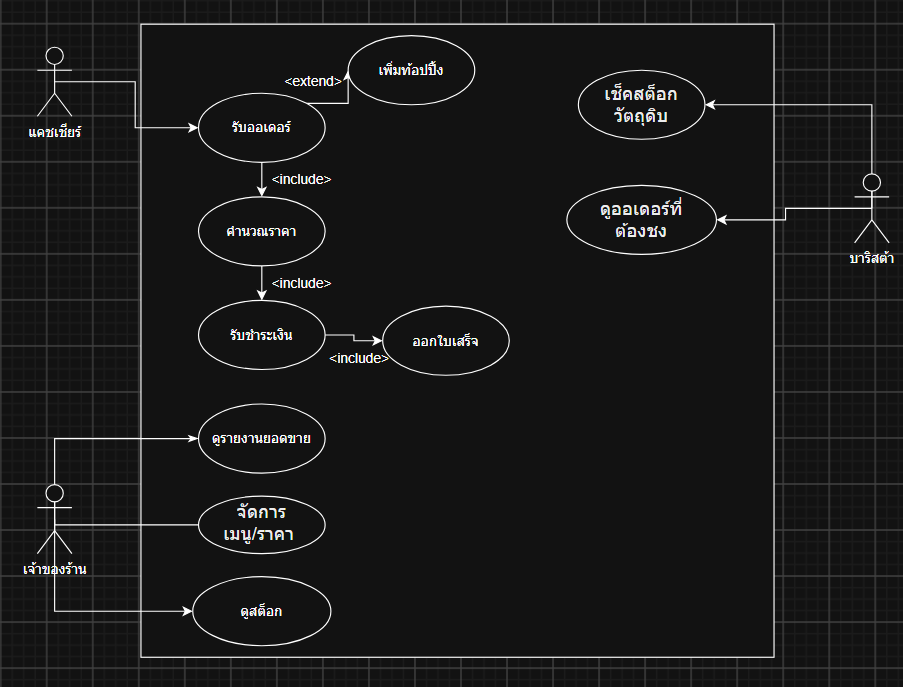

# เอกสารข้อกำหนดความต้องการทางซอฟต์แวร์ (SRS)
**โครงการ:** ระบบจัดการร้านกาแฟ Buumonkey Cafe (Cafe POS & Inventory System)  
**ชื่อไฟล์งาน:** `wk10-srs.md`

---

## 1. Introduction (บทนำและขอบเขต)

### 1.1 ระบบทำอะไร
ระบบ **Buumonkey Cafe POS & Inventory System** เป็นระบบบริหารจัดการการขายหน้าร้านและการควบคุมสต็อกวัตถุดิบแบบเรียลไทม์ ช่วยให้พนักงานแคชเชียร์เลือกเมนู ปรับระดับความหวาน เพิ่มท็อปปิ้ง และคิดเงินคำนวณราคารวมสุทธิได้อย่างรวดเร็วและถูกต้อง ระบบส่งคิวรายการออเดอร์ไปยังหน้าจอของบาริสต้าโดยอัตโนมัติ พร้อมออกใบเสร็จดิจิทัลผ่าน QR Code ให้แก่ลูกค้า ช่วยลดการใช้กระดาษและป้องกันความผิดพลาดจากการจดออเดอร์หน้าร้านช่วง Peak Time นอกจากนี้ ระบบยังมีฟังก์ชันตัดสต็อกวัตถุดิบตามสูตรทันทีที่ขาย แจ้งเตือนเมื่อวัตถุดิบใกล้หมด และสรุปรายงานยอดขายแบบเปรียบเทียบหลายสาขาให้เจ้าของร้านใช้ในการบริหารจัดการ

### 1.2 ขอบเขตที่ครอบคลุม (In-Scope)
* **การรับและจัดการออเดอร์หน้าร้าน (Take & Record Order):** เลือกเมนู ปรับระดับความหวาน และเพิ่มท็อปปิ้ง/ออปชันเสริม
* **การคำนวณราคาและชำระเงิน (Calculate & Process Payment):** คำนวณราคารวมสุทธิให้อัตโนมัติ รองรับการชำระเงินทั้งเงินสดและ QR Code
* **การออกใบเสร็จดิจิทัล (Issue Digital Receipt):** แสดง QR Code สำหรับรับใบเสร็จดิจิทัลบนหน้าจอให้ลูกค้าสแกน
* **การจัดการคิวเครื่องดื่ม (Order Queue):** แสดงคิวและรายละเอียดออเดอร์พร้อมท็อปปิ้งให้บาริสต้าเรียงตามเวลา
* **การควบคุมสต็อกวัตถุดิบ (Manage Inventory):** ตัดจำนวนสต็อกวัตถุดิบตามสูตรเมนูอัตโนมัติเมื่อชำระเงินสำเร็จ และแจ้งเตือนสต็อกต่ำกว่าเกณฑ์
* **ระบบรายงานสรุปสำหรับเจ้าของร้าน (Financial & Multi-branch Report):** รายงานสรุปรายรับ-รายจ่าย กำไรสุทธิ และการเปรียบเทียบยอดขายระหว่างสาขา

### 1.3 ขอบเขตที่ไม่ครอบคลุม (Out-of-Scope)
* **ระบบบัญชีเต็มรูปแบบและระบบภาษี:** ระบบเน้นจัดการการขายหน้าร้านและสต็อกวัตถุดิบ ไม่รองรับการลงบัญชีคู่หรือการคำนวณภาษีซับซ้อน
* **ระบบสมาชิกสะสมแต้ม:** ยังไม่รองรับการสะสมแต้ม ระดับสมาชิก (Tier) หรือส่วนลดสมาชิกในเวอร์ชันนี้
* **การเชื่อมต่อ Payment Gateway จริง:** บันทึกสถานะการชำระเงินด้วยเงินสด หรือสแกน QR Code หน้าจอระบบโดยไม่มีการเรียกใช้ API สถาบันการเงินจริง
* **แอปพลิเคชันสำหรับลูกค้า:** สั่งซื้อผ่านแคชเชียร์หน้าร้านเท่านั้น ไม่รองรับแอปพลิเคชันสั่งอาหารบนมือถือลูกค้า

---

## 2. Overall Description (ภาพรวมของระบบ)

### 2.1 กลุ่มผู้ใช้งาน (Roles & Responsibilities)

| บทบาท | หน้าที่และการใช้งานระบบ |
| :--- | :--- |
| **แคชเชียร์ (Cashier)** | บันทึกออเดอร์, เลือกเมนู/ท็อปปิ้ง, คำนวณเงิน, ดำเนินการรับชำระเงิน (เงินสด/QR Code) |
| **ลูกค้า (Customer)** | ชำระเงินตามช่องทางที่เลือก และสแกนรับใบเสร็จดิจิทัลผ่าน QR Code |
| **บาริสต้า (Barista)** | ดูรายการออเดอร์ในคิว ปรุงเครื่องดื่มตามรายละเอียด/ท็อปปิ้ง และอัปเดตสถานะออเดอร์ |
| **เจ้าของร้าน (Owner)** | ตรวจสอบสต็อก/การตัดสต็อก, ดูรายงานยอดขายรวม, รายงานกำไรสุทธิ และเปรียบเทียบยอดขายหลายสาขา |

#### Use Case Summary

* **แคชเชียร์:** `รับและบันทึกออเดอร์` (`<<extend>>` `เพิ่มท็อปปิ้ง/ออปชันเสริม`), `รับชำระเงิน` (`<<include>>` `คำนวณราคารวมสุทธิ`), `ออกใบเสร็จดิจิทัล` (`<<include>>` `ตัดสต็อกวัตถุดิบอัตโนมัติ`)
* **บาริสต้า:** `ดูรายการออเดอร์ในคิวและเตรียมเครื่องดื่ม`
* **เจ้าของร้าน:** `ตรวจสอบและจัดการสต็อกวัตถุดิบ`, `ดูรายงานสรุปยอดขายและรายรับ-รายจ่าย`, `เปรียบเทียบยอดขายหลายสาขา`

### 2.2 ข้อจำกัดและสมมติฐาน (Constraints & Assumptions)
* **Constraints:**
  * Backend พัฒนาด้วย Node.js / Express และใช้ MySQL เป็นระบบจัดการฐานข้อมูล
  * แสดงผลระบบหน้าร้านผ่าน **แท็บเล็ต Android ทั่วไป**
  * รหัสผ่านผู้ใช้ทุกคนต้องได้รับการเข้ารหัสด้วย `bcrypt`
  * ระยะเวลาพัฒนาระบบรวมทั้งสิ้น **3 - 4 เดือน**
* **Assumptions:**
  * แท็บเล็ตของแคชเชียร์และบาริสต้าในสาขาเดียวกันเชื่อมต่อผ่านเครือข่าย Wi-Fi/Internet เดียวกัน
  * การตัดสต็อกวัตถุดิบคำนวณจากปริมาณมาตรฐานต่อแก้วตามสูตรที่ตั้งไว้ในระบบ

---

## 3. Specific Requirements (ความต้องการของระบบ)

### 3.1 Functional Requirements (FR)

| รหัส | ข้อกำหนดความต้องการ | ที่มาจาก Use Case / Requirement Definition |
| :--- | :--- | :--- |
| **FR-01** | ระบบต้องสามารถบันทึกออเดอร์ และเลือกเมนูเครื่องดื่มลงตะกร้าได้ | FR-01 / US-01 (Take & Record Order) |
| **FR-02** | ระบบต้องรองรับการเลือกเพิ่มท็อปปิ้ง/ออปชันเสริม (เช่น เพิ่มช็อต/ระดับความหวาน) พร้อมปรับราคาเพิ่มทันที | FR-02 / US-02 (Add Toppings) |
| **FR-03** | ระบบต้องคำนวณราคารวมและยอดสุทธิให้อัตโนมัติทันทีที่มีการเปลี่ยนแปลงรายการ | FR-03 / US-03 (Calculate Total Price) |
| **FR-04** | ระบบต้องรองรับการบันทึกการรับชำระเงินทั้งเงินสด (แสดงเงินทอน) และสร้าง QR Code สำหรับสแกนชำระ | FR-04 / US-04, US-05 (Process Payment) |
| **FR-05** | ระบบต้องแสดง QR Code บนหน้าจอ เพื่อให้ลูกค้าสแกนรับใบเสร็จดิจิทัลได้ทันทีหลังชำระเงินสำเร็จ | FR-06 / US-07 (Issue Digital Receipt) |
| **FR-06** | ระบบต้องทำการตัดจำนวนสต็อกวัตถุดิบตามสูตรเมนูอัตโนมัติทันทีที่ชำระเงินสำเร็จ และแสดงข้อความเตือนเมื่อสต็อกต่ำกว่าเกณฑ์ (Safety Stock) | FR-05 / US-06 (Manage Inventory & Stock) |
| **FR-07** | ระบบต้องแสดงรายการออเดอร์ในคิวเรียงตามเวลา พร้อมรายละเอียดท็อปปิ้ง บนหน้าจอของบาริสต้า | FR-08 / US-09 (Order Queue & Prepare Drinks) |
| **FR-08** | ระบบต้องให้เจ้าของร้านเข้าดูรายงานสรุปรายรับ-รายจ่าย ยอดขาย และกำไรสุทธิตามช่วงเวลา (รายวัน/รายเดือน/รายปี) ได้ | FR-09 / US-10 (Financial Report) |
| **FR-09** | ระบบต้องรองรับการแสดงกราฟรายงานเปรียบเทียบยอดขายระหว่างสาขาได้ | FR-07 / US-08 (Multi-branch Sales Monitoring) |

---

### 3.2 Non-Functional Requirements (NFR)

| รหัส | ประเภท | ข้อกำหนดความต้องการ |
| :--- | :--- | :--- |
| **NFR-01** | **Performance** | ระบบต้องคำนวณราคา ประมวลผลการชำระเงิน และส่งข้อมูลออเดอร์เข้าคิวบาริสต้าภายในเวลา 5 - 10 วินาที |
| **NFR-02** | **Availability** | ระบบต้องมีความพร้อมใช้งานไม่น้อยกว่า 99% ของเวลาทำการของร้าน |
| **NFR-03** | **Usability / Portability** | ตัวระบบต้องรองรับการแสดงผลและใช้งานผ่านแท็บเล็ต Android หน้าร้านได้อย่างสะดวกและคล่องตัว |
| **NFR-04** | **Security** | ระบบต้องทำการเข้ารหัสรหัสผ่านผู้ใช้งานทุกคนด้วยเทคนิค `bcrypt` ก่อนจัดเก็บลงฐานข้อมูล |

---

### 3.3 External Interface Requirements
* **User Interface:** หน้าจอรับออเดอร์บนแท็บเล็ตออกแบบให้รองรับ Touchscreen ปุ่มเมนูกาแฟ เครื่องดื่ม และตัวเลือกท็อปปิ้งมีขนาดใหญ่ คัดแยกหมวดหมู่ชัดเจน
* **Digital Receipt Interface:** หน้าจอแสดงผล QR Code สำหรับให้ลูกค้าใช้กล้องมือถือสแกนเปิดอ่านใบเสร็จรับเงินแบบดิจิทัล

---

### 3.4 รายงานในระบบ (Report Requirements)

| ประเภทรายงาน | ชื่อรายงาน | ผู้ใช้งาน | จุดประสงค์การใช้งาน |
| :--- | :--- | :--- | :--- |
| **Detail Report** | รายงานรายการออเดอร์และคิวเครื่องดื่ม | บาริสต้า / แคชเชียร์ | ตรวจสอบรายละเอียดการชง ท็อปปิ้ง และประวัติออเดอร์ย้อนหลัง |
| **Summary Report** | รายงานสรุปรายรับ-รายจ่าย และกำไรสุทธิ | เจ้าของร้าน | ประเมินผลประกอบการธุรกิจรายวัน รายเดือน และรายปี |
| **Exception Report** | รายงานแจ้งเตือนวัตถุดิบใกล้หมด (Safety Stock) | เจ้าของร้าน / แคชเชียร์ | ตรวจสอบรายการวัตถุดิบที่ต้องสั่งซื้อเติมด่วน |
| **Comparative Report**| รายงานเปรียบเทียบยอดขายแบบหลายสาขา | เจ้าของร้าน | วิเคราะห์แนวโน้มตลาดและเปรียบเทียบประสิทธิภาพของแต่ละสาขา |
| **On-demand** | รายงานสรุปสต็อกคงเหลือ ณ ปัจจุบัน | เจ้าของร้าน | เรียกดูปริมาณวัตถุดิบคงเหลือจริงในระบบได้ทันทีทุกเวลา |

---

### 3.5 Data Requirements (Logical Data Model)

**Entity หลักในระบบ:**
1. **BRANCH:** `branch_id` (PK), `branch_name`, `location`
2. **USER:** `user_id` (PK), `username`, `password_hash` *(bcrypt)*, `role` *(Cashier/Barista/Owner)*, `branch_id` (FK)
3. **MENU_ITEM:** `menu_id` (PK), `name`, `price`, `category`
4. **TOPPING:** `topping_id` (PK), `name`, `price`
5. **INGREDIENT:** `ingredient_id` (PK), `name`, `unit`, `min_stock_level`
6. **RECIPE:** `recipe_id` (PK), `menu_id` (FK), `ingredient_id` (FK), `quantity_used`
7. **ORDERS:** `order_id` (PK), `branch_id` (FK), `user_id` (FK), `total_amount`, `payment_method` *(Cash/QR)*, `status` *(Pending/Preparing/Completed)*, `created_at`
8. **ORDER_ITEM:** `order_item_id` (PK), `order_id` (FK), `menu_id` (FK), `quantity`, `unit_price`
9. **ORDER_ITEM_TOPPING:** `item_topping_id` (PK), `order_item_id` (FK), `topping_id` (FK), `price`
10. **INVENTORY:** `inventory_id` (PK), `branch_id` (FK), `ingredient_id` (FK), `stock_quantity`
